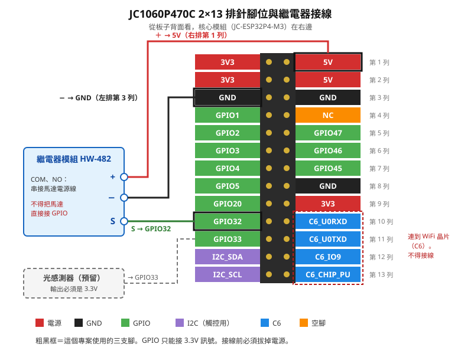
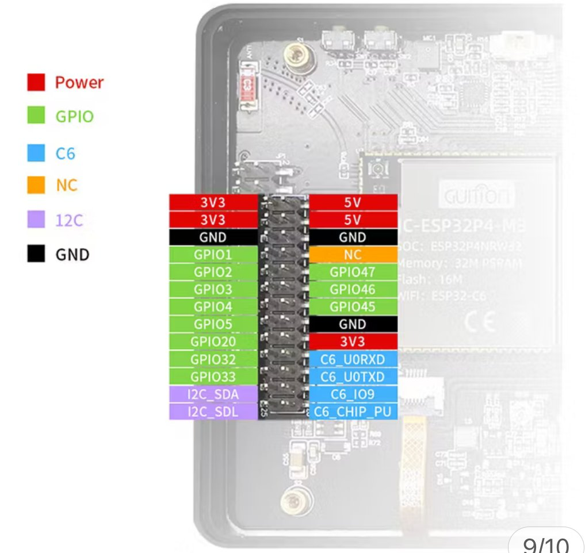

# ESP32-P4 開發板：新板上線流程（可重複使用）

每買一塊同型號的板子，照這份文件從頭做一次。第一塊板子（序號 `80:F1:B2:D3:B4:D2`）在 2026-11-22 做到階段 4：程式已燒進 P4、開機正常、看得到 C6；WiFi、裝置代碼、馬達腳位還沒設定。

## 0. 原則：怎樣才不會把板子弄到無法更新

板子上有兩顆晶片，風險不同。

| 晶片 | 怎麼燒 | 會不會救不回來 | 救援方法 |
|---|---|---|---|
| ESP32-P4（主晶片） | USB-C 接 UART 孔 | 不會。下載程式在晶片的 ROM 裡，flash 寫壞也能重燒 | 按住 `BOOT`、按一下 `RST`、放開 `BOOT`，再用 esptool 燒回備份 |
| ESP32-C6（WiFi） | 只能由 P4 經 SDIO 傳（OTA），或用 `PROG_C6` 排針 | 會。新韌體如果無法和 P4 通訊，P4 就再也傳不進去 | 只剩 `PROG_C6` 排針＋3.3V USB-UART 轉接器 |

五條規則：

1. **不得動 eFuse。** 不得執行 `espefuse.py burn_*`；不得在 menuconfig 開 Secure Boot、Flash Encryption。eFuse 寫了不能改，這是 P4 唯一救不回來的路。
2. **寫入 flash 前，必須有備份，而且備份比對過。** 備份必須放在兩個地方（見階段 2）。
3. **先做能還原的事，再做不能還原的事。** 順序固定：備份 → 燒 P4 → 最後才考慮 C6。
4. **升級 C6 前，救援工具必須在手上**（階段 5 的檢查表）。沒有就不升級。
5. **燒錄或 OTA 進行中，不得拔線、斷電、關筆電螢幕。**

esptool 拒絕燒錄時（例：`requires chip revision in range ...`），不得加 `--force`。先找出設定哪裡不符。

## 1. 連線與辨識（不寫入）

1. 用能傳資料的 USB-C 線，接板子的 **UART 孔**，直接插 Mac 機身。
2. Mac 跳出「允許配件連線？」時按「允許」。沒按之前，USB 清單裡完全看不到板子。
3. 確認序列埠：`ls /dev/cu.usbmodem*`（第一塊是 `/dev/cu.usbmodem101`）。
4. 讀開機 log，存檔留底：
   ```sh
   . ~/esp/idf-env.sh
   idf.py -p /dev/cu.usbmodem101 monitor   # Ctrl+] 離開；另存成 bootlog_<日期>.txt
   ```
5. 對照下表。**任何一項不同，就停下來**：表示不是同一批板子，後面的設定不能直接套用。

| 項目 | 第一塊的值 |
|---|---|
| 晶片 | `ESP-ROM:esp32p4-eco2`，chip revision v1.3（v3.x 的板子必須拿掉 `sdkconfig.defaults` 的 `CONFIG_ESP32P4_SELECTS_REV_LESS_V3=y`） |
| Flash／PSRAM | 16MB／32MB |
| 螢幕／觸控 | JD9165 1024×600／GT911（開機 log 寫 `Install EK79007`，那是 BSP 留下的字串，不是實際面板。見 4.2） |
| C6 | `Identified slave [esp32c6]`，`Reset slave using GPIO[54]` |
| C6 韌體版本 | 2.3.0（log 的 `Co-proc [x.y.z]`） |
| 出廠程式 | `esp_brookesia_demo`，ESP-IDF v5.5.4 |

不要用網路孔來燒錄：燒錄與 log 只走 USB。出廠程式不使用乙太網路；我們的程式會用（見 4.3）。

### 1.1 板子介面（來源：賣場商品頁，2026-11-22 Jeff 提供截圖）

型號：Guition JC1060P470C（7 吋 1024×600），核心模組 JC-ESP32P4-M3（ESP32-P4NRW32、32MB PSRAM、16MB Flash、ESP32-C6）。

| 編號 | 介面 | 我們的用途／狀態 |
|---|---|---|
| 1 | BOOT 按鈕 | 救援燒錄時用 |
| 2 | 重置按鈕 | 重開機 |
| 3 | MX1.25 2P 喇叭 | 未使用 |
| 4 | TF 卡座 | 未使用（之後可放各場館待機圖） |
| 5 | MX1.25 2P 鋰電池 | 未使用 |
| 6 | 電池按鈕 | 未使用 |
| 7 | 全速 Type-C | USB Serial/JTAG：接電腦燒錄、看 log、抓畫面（已驗證） |
| 8 | MX1.25 4P UART1 | 未使用（序列埠掃碼器可接這裡） |
| 9 | 高速 Type-C | USB 2.0 OTG HS：接掃碼器、鍵盤、讀卡機（未驗證，需要 Type-C 轉 USB-A 母座；是否輸出 5V 未確認） |
| 10 | MX1.25 4P UART0 | 主控台 UART（log 也從這裡輸出） |
| 11 | MX1.25 4P RS485 | 未使用 |
| 12 | SH1.0 4P I2C | 未使用 |
| 13 | 百兆網路孔 | 有線網路（IP101，見 4.3） |
| 14 | RTC 電池座 | 未使用 |
| 15 | 30P 0.5 FPC MIPI | 螢幕排線 |
| 16 | JC-ESP32P4-M3 | 核心模組 |
| 17 | 6P 0.5 FPC | 觸控排線 |
| 18 | 2×13 2.54 排針 | GPIO：接繼電器與光感測器（腳位表見 1.2） |

- USB 裝置的限制（2026-11-22 實測）：
  - 必須開 `CONFIG_USB_HOST_HUBS_SUPPORTED`，集線器後面的裝置才會被偵測（已寫進 `sdkconfig.defaults`）。
  - 低速裝置（多數 USB 鍵盤）接在高速集線器後面不能用。log：`HUB: Connected device is LS, transaction translator (TT) is not supported`。這是 ESP-IDF USB Host 的限制。
  - 對策：裝置用 Type-C 轉 USB-A 母座直接接高速 Type-C 孔（不經集線器）；或用序列埠掃碼器接 UART1。
  - 全速裝置（多數掃碼器）接在高速集線器後面能不能用：未確認。
- 板子沒有 USB-A 孔。兩個 Type-C 的分工：全速那個接電腦，高速那個接 USB 裝置。
- 商品頁寫「內置 200 萬像素攝影機」：未確認。板上有 MIPI-CSI 介面；有沒有附鏡頭要看實物。相機掃 QR Code 的方案要先確認這一點。
- 商品頁是機器翻譯，有錯字。廠商資料在螢幕型號與重置腳位上錯過（見 4.2），這張表沒實測的項目都算未確認。

### 1.2 2×13 排針腳位與繼電器接線（2026-11-23）

來源：賣場「引腳定義」圖，Jeff 2026-11-23 提供截圖。原圖存在 `images/header-pinout-seller.jpg`。



賣場原圖：



**腳位表**（從板子背面看、核心模組在右邊，由上到下）

| 列 | 左排 | 右排 |
|---|---|---|
| 1 | 3V3 | **5V ← 繼電器 `+`** |
| 2 | 3V3 | 5V |
| 3 | **GND ← 繼電器 `-`** | GND |
| 4 | GPIO1 | NC |
| 5 | GPIO2 | GPIO47 |
| 6 | GPIO3 | GPIO46 |
| 7 | GPIO4 | GPIO45 |
| 8 | GPIO5 | GND |
| 9 | GPIO20 | 3V3 |
| 10 | **GPIO32 ← 繼電器 `S`** | C6_U0RXD |
| 11 | GPIO33（光感測器，預留） | C6_U0TXD |
| 12 | I2C_SDA | C6_IO9 |
| 13 | I2C_SCL | C6_CHIP_PU |

**繼電器模組（HW-482）接線**

| 繼電器模組 | 排針 | 線色建議 |
|---|---|---|
| `+` | 右排第 1 列，5V | 紅 |
| `-` | 左排第 3 列，GND（三支 GND 任一支都可以） | 黑 |
| `S` | 左排第 10 列，GPIO32 | 綠 |
| `COM`、`NO` | 串接在馬達的電源線上。不接排針 | — |

**韌體設定**：`idf.py menuconfig` 把 `GOLF_MOTOR_GPIO` 設成 `32`。預設 -1 = 馬達停用。

**為什麼選這兩支**

- GPIO32、GPIO33 不是 strapping 腳位，板上沒有其他用途。
- 不得用 GPIO34 到 38（strapping，不在排針上）。
- GPIO2 到 5 預設是 JTAG；GPIO20 在廠商 `board_pins.h` 標成功放控制；I2C 兩支接觸控晶片。
- 右排第 10 到 13 列接 ESP32-C6（`PROG_C6` 救援燒錄用，見 5.3）。不得接其他東西。

**接線注意**

- 接線前拔掉板子的電源。
- GPIO 是 3.3V。輸入超過 3.3V 會損壞腳位。光感測器的輸出必須是 3.3V。
- 不得把馬達直接接 GPIO。
- 板子開機時 GPIO32 維持 LOW，繼電器不會動作。
- 第一次通電先不接馬達，只確認繼電器的指示燈與聲音。

**出球方式與需要的硬體**（後台 `take_ball` 回的 `type`）

| type | 出球方式 | 需要的硬體 | 韌體 |
|---|---|---|---|
| 1 | 連續通電一段時間 | 繼電器 | 已支援 |
| 2 | 通電 `start_timer` 秒、斷電 `interval_timer` 秒，重複「盤數」次（盤數 = 取球數 ÷ `ball_per_plate`，無條件進位） | 繼電器 | 已支援 |
| 其他 | 光感測器數盤數 | 繼電器＋光感測器 | 未支援 |

**狀態**

- 未驗證：腳位來自賣場圖片。接線前用三用電表確認 5V、3V3、GND 的位置。
- 未驗證：繼電器實際動作（2026-11-23 還沒接線）。

## 2. 備份出廠程式（只讀取）

```sh
. ~/esp/idf-env.sh
SN=<序號去掉冒號，小寫>            # 例：80f1b2d3b4d2
D=~/esp/backup/esp32p4-$SN && mkdir -p $D && cd $D
esptool.py --chip esp32p4 -p /dev/cu.usbmodem101 -b 921600 read_flash 0 0x1000000 factory_16MB_$(date +%F).bin
esptool.py --chip esp32p4 -p /dev/cu.usbmodem101 -b 921600 verify_flash 0 factory_16MB_*.bin   # 必須出現 verify OK
shasum -a 256 factory_16MB_*.bin > factory_16MB.sha256
```

- 通過條件：`verify OK (digest matched)`。
- 第二份備份：把整個 `~/esp/backup/esp32p4-$SN/` 複製到 Mac 以外的地方（雲端硬碟或 NAS）。
- 這份備份只包含 P4 的 flash。**C6 的出廠韌體無法經由 P4 備份。**

還原 P4（隨時可做）：

```sh
esptool.py --chip esp32p4 -p /dev/cu.usbmodem101 -b 921600 write_flash 0 ~/esp/backup/esp32p4-$SN/factory_16MB_*.bin
```

## 3. 開發環境（每台 Mac 做一次）

```sh
mkdir -p ~/esp && cd ~/esp
git clone -b v5.5.6 --depth 1 --recursive --shallow-submodules https://github.com/espressif/esp-idf.git esp-idf-v5.5.6
# Apple 晶片的 Mac：必須用 arm64 的 Python（3.9 以上）。先把它放到 PATH 最前面再安裝
cd esp-idf-v5.5.6 && ./install.sh esp32p4
```

- `~/esp/idf-env.sh` 負責載入環境（設定 Python 路徑，再 `source export.sh`）。
- 需要約 3.5GB 硬碟空間（ESP-IDF 0.7GB＋工具 2.6GB），建置輸出另計。
- 驗證：
  ```sh
  cd firmware && idf.py set-target esp32p4 && idf.py build   # 0 error
  make -C test_host                                           # 全部通過
  ```
- 元件版本以 `dependencies.lock` 為準。`esp_hosted` 鎖在 2.11.x；不得改成 `"*"`（會抓到 3.x）。

## 4. 把我們的程式燒進 P4（可還原）

前置：階段 2 的備份已比對、已有第二份。

1. `idf.py menuconfig` 設定 WiFi SSID、密碼、裝置代碼、`GOLF_MOTOR_GPIO`。這些值只存在 `sdkconfig`，不進 git。
2. **第一次燒錄時，馬達腳位先不接繼電器。**
3. `idf.py -p /dev/cu.usbmodem101 flash monitor`
4. 通過條件：
   - 開機 log 沒有 panic、沒有重開機循環（觀察 40 秒，`ESP-ROM:` 只出現 1 次）。
   - 看得到 `Identified slave [esp32c6]`。**WiFi SSID 空白時程式不啟動 C6，看不到這行**；只想檢查 C6 時，可以先填一個假的 SSID。
   - 記下 WiFi 是否連得上、有沒有 `Version mismatch` 與 RPC 逾時訊息。

menuconfig 的項目都在「Golfriend Ball Dispenser」選單：

| 項目 | 說明 |
|---|---|
| `GOLF_DEVICE_CODE` | 裝置代碼，同 Pi 版 `Desktop/DeviceName`（例：`TGSGF_1F_M1`）。空白時 API 停用 |
| `GOLF_API_BASE_URL` | 預設 `http://golfpoint.milkidea.com/api` |
| `GOLF_MOTOR_GPIO` | 繼電器訊號腳位。預設 -1 = 不設，馬達停用，客人不會被扣點。不得用 strapping 腳位 |
| `GOLF_WIFI1_SSID`／`GOLF_WIFI1_PASSWORD` | 主要 WiFi |
| `GOLF_WIFI2_SSID`／`GOLF_WIFI2_PASSWORD` | 備援 WiFi，可不填 |

第一塊板子 2026-11-22 的結果：開機正常；`Identified slave [esp32c6]`；`Version mismatch: Host [2.11.0] > Co-proc [2.3.0]`；出現一次 `Hosted RPC_Resp [0x21a] ... resp code [12298]`（出廠程式也有同一行）。
5. 失敗時：照階段 2 還原出廠程式，板子回到原狀。

**決策點**：C6 還是 2.3.0 時，如果 WiFi 連線、斷線重連、切換備援都正常，就不升級 C6。能不動 C6 就不動。

### 4.1 第一塊板子的 WiFi 實測（2026-11-22，C6 韌體 2.3.0、host esp_hosted 2.11.7）

| 測試 | 結果 |
|---|---|
| WiFi 連線 | 通過。開機後約 8–15 秒拿到 IP（`sta ip: 10.108.1.161`）。有一次第一次嘗試失敗，2 秒後重試成功 |
| SNTP 對時 | 通過。`time synced: 2026-11-22 05:18:39 UTC`，和 Mac 相差 1 秒內。拿到 IP 後 2–34 秒完成（3 次開機：34、4、2 秒） |
| 斷線重連（關分享器） | 通過。3 次斷線都自己連回來，各花 13.8 秒、約 26 秒、7 秒；每次都是 2 秒後重試、1 次就連上；板子沒有重開機 |
| 30 分鐘閒置監看 | RPC 逾時 0 次、重開機 0 次、panic 0 次；斷線 1 次（上表第 3 次） |
| `Version mismatch` 警告 | 每次開機都出現，沒有造成逾時 |

依 4 的決策點：**C6 先不升級。** 範圍限制：監看時板子閒置，沒有 API 流量。

現場注意：測試場地有 2 台同名（同 SSID）的基地台，網段不同（`10.108.1.x` 與 `192.168.1.x`）。
關掉一台時，板子 5 秒內連到另一台，IP 換網段。主要／備援的切換規則依 SSID 分，
同名的基地台程式分不出來。裝機時必須確認同名的基地台都能連到 API 伺服器。

斷線時 log 會印原因碼：`wifi_mgr: disconnected from [0] <SSID>: reason=<碼> rssi=<訊號>`。
常見的碼（`wifi_err_reason_t`）：8 = 自己離線、15 = 密碼錯（4-way handshake 逾時）、
200 = beacon 逾時（基地台不見了）、201 = 找不到 AP。

### 4.2 螢幕（2026-11-22 實測）

出廠程式的 log 與廠商公開文件都不可信。下表的值是從出廠備份的程式碼讀出來的，並已在面板上驗證。

| 項目 | 值 | 廠商資料的錯誤 |
|---|---|---|
| 面板驅動 | JD9165（`esp_lcd_new_panel_jd9165`） | 開機 log 寫 EK79007 |
| 重置腳位 | GPIO0 | `board_pins.h` 寫 GPIO27 |
| 初始化指令 | 60 筆，在 `components/ui/ui_panel_jd9165_cmds.h` | 公開的 `setup_device.c` 是給「LCD V1」的另一組，用了會出現灰白條紋 |
| DSI | 2 lane、550 Mbps | — |
| 像素時脈 | 52 MHz | — |
| 水平時序 | 脈寬 24／後沿 136／前沿 160 | — |
| 垂直時序 | 脈寬 2／後沿 21／前沿 12 | — |
| 背光 | GPIO23，PWM 20 kHz | — |
| 面板電源 | LDO 通道 3，2500 mV | — |

- 重置腳位錯的時候，面板暫存器不會回到預設值。MCU 重開後，面板還留著上一版程式寫的設定。現象：底色偏藍或偏淡、文字上下有直條紋、畫面時有時無。面板斷電才會清掉。
- 驗證重置腳位的方法：在某個暫存器寫入特別的值，拉低候選腳位，再讀回。值回到預設，就是正確的腳位。
- 讀出廠設定的方法：解析備份檔的 app（位移 0x10000），用 `riscv32-esp-elf-objdump` 反組譯，找呼叫 `esp_lcd_new_panel_*` 的函式與它的參數表。
- 新一批板子的面板不同時，必須重做這三步，不得直接沿用本表。

抓畫面（開發用）：menuconfig 開 `GOLF_UI_DEBUG_CONSOLE`，執行 `python3 tools/ui_capture.py /dev/cu.usbmodem101 out.png [畫面字元]`。它讀畫面記憶體，約 2 秒一張，不會重置板子。它抓到的是程式畫的內容；面板的偏色、條紋抓不到，必須看實物。出貨韌體必須關閉這個選項。

中文字型：只收錄字串用到的字。改了畫面上的中文字串後，執行 `python3 tools/gen_ui_font.py <NotoSansTC-Medium.ttf>`（字型從 Google Fonts 下載，OFL 授權）。`make -C test_host` 會檢查缺字。

### 4.3 有線網路（2026-11-22）

- 晶片：IP101（RMII）。腳位和 ESP-IDF 給 ESP32-P4 的預設值相同：MDC 31、MDIO 52、TX_EN 49、TXD0 34、TXD1 35、CRS_DV 28、RXD0 29、RXD1 30、時脈 GPIO50（外部輸入）、PHY 重置 GPIO51。
- 已驗證：開機 log 出現 `ethernet attached to netif` 與 `eth_mgr: started`（驅動從 MDIO 讀到 IP101）。
- 已驗證（2026-11-23）：插網路線後由 DHCP 拿到 IP，狀態列顯示 `LAN`，定期回報改從有線的 IP 送出（後台回 200）。
- 已驗證（2026-11-23）：拔線後自動改走 WiFi，狀態列回到 WiFi 名稱，回報的 IP 變回 WiFi 的 IP，後台回 200。
- 規則：有線有 IP 就走有線（預設路由優先度 200，WiFi 100）。WiFi 同時保持連線當備援。
- 沒插網路線時，開機多等約 4 秒（PHY 自動協商逾時）。

### 4.4 現場設定：TF 卡（2026-11-23）

安裝人員不必重新編譯韌體。在 TF 卡（FAT32）根目錄放下列檔案，插卡後重開機：

| 檔案 | 內容 | 存到哪裡 |
|---|---|---|
| `config.txt` | 一行一項 `key=value`：`device_code`、`wifi1_ssid`、`wifi1_password`、`wifi2_ssid`、`wifi2_password`、`log_token`、`ota_url`。`#` 開頭是註解。沒寫的項目維持原值 | NVS |
| `standby.jpg` | 待機圖：1024×600、baseline JPEG（不是 progressive）、小於 1 MB | Flash 的 `standby` 分割區 |

- 匯入成功時，螢幕顯示「記憶卡」與匯入結果 3 秒。之後可以取出卡片，設定留在板子裡。
- 卡片留在板子上也可以：內容相同時不重寫 Flash。
- 沒插卡、沒有檔案都不算錯誤，板子用已存的設定；從沒匯入過時用 menuconfig 的值與編進韌體的預設圖。
- 輸入維修碼 `7777777` 開系統選單，可以看到目前的裝置代碼、版本、網路、IP。
- 已驗證：沒插卡時開機正常。未驗證：實際從卡片匯入。TF 卡的 IO 電源用晶片內建 LDO 通道 4，這是推論（廠商檔案寫通道 3，但通道 3 是螢幕用的），第一次插卡時確認。
- `config.txt` 有 WiFi 密碼。匯入後請把卡片收好或刪除檔案。

### 4.5 遠端 log（2026-11-23）

- 板子把重要事件送到 Better Stack（Logtail），欄位與 Pi 版 `log.py` 相同：`dt`、`level`、`message`（`[裝置] [標籤] 內容`）、`device`、`tag`。所以可以用同一個儀表板查 Pi 與 ESP32。
- 送出的事件：開機（版本、重置原因）、WiFi／有線連線變化、`take_ball` 成功與失敗（含領球碼與錯誤代碼）、扣點確認、出球開始／完成／中斷、從系統選單重開機。
- 每 5 秒送一批，一批最多 20 筆。送不出去時重試約 30 秒，之後丟掉那一批；不影響領球。
- token：TF 卡 `config.txt` 的 `log_token=`，或 menuconfig 的 `GOLF_LOG_TOKEN`（存在 `sdkconfig`，不進 git）。沒有 token 時不送。不得把 token 寫進程式碼或文件。
- 已驗證：Better Stack 查得到 `TEST_0010` 的開機與 WiFi 事件。

### 4.6 韌體遠端更新 OTA（2026-11-23）

**運作方式**

- 分割表有兩個 app 分割區（`ota_0`、`ota_1`）。新版下載到沒在用的那一個，重開機後執行。
- 板子開機後第一次成功回報後台，才開始檢查更新；之後每 6 小時檢查一次（`GOLF_OTA_CHECK_INTERVAL_H`）。系統選單（維修碼 `7777777`）的「檢查更新」可以立刻檢查。
- 只在待機時更新。有人在領球時延後 10 分鐘。更新中畫面顯示「系統更新中，請勿關閉電源」，不接受輸入。
- 只升級，不降版；機型代號不同（不是 `P4-`）的韌體不裝。
- 下載網址必須是 `https://`。

**退回機制**

- 新版第一次開機是「待確認」。它成功回報後台（`take_ball_ping` 回 200）後才標記為正常。
- 在那之前重開機（當機、斷電、連不上後台後被重開），bootloader 會退回上一版。
- 被退回的版本號會記住，不再下載。修正後必須用新的版本號發布。

**發布新版的步驟**

1. 改 `firmware/CMakeLists.txt` 的 `PROJECT_VER`（格式 `P4-主.次.修`，數字只能變大）。
2. `idf.py build`，取出 `build/golfriend_p4.bin`。
3. 把 `.bin` 放到 HTTPS 伺服器。
4. 更新同一台伺服器上的版本說明檔：`{"version":"P4-0.1.2","url":"https://.../golfriend_p4.bin"}`。
5. 先讓一台測試機更新並確認正常，再放給其他場館。版本說明檔一改，所有板子都會在 6 小時內更新。

板子要知道版本說明檔的網址：TF 卡 `config.txt` 的 `ota_url=`，或 menuconfig 的 `GOLF_OTA_URL`。沒設定時不做遠端更新。

**第一次改用這個分割表時必須用 USB 燒錄一次**（`idf.py flash`）。NVS 的位置沒變，現場設定會保留；待機圖分割區的位置變了，要重新匯入 `standby.jpg`。

**已驗證（實機，測試伺服器是區域網路上的電腦）**

| 情境 | 結果 |
|---|---|
| 0.1.0 → 0.1.1 自動更新 | 下載約 15 秒，重開後執行新版，回報後台後 `new version confirmed` |
| 0.1.2 開機後、回報後台前被重置 | bootloader 退回 0.1.1 |
| 退回後再檢查更新 | `P4-0.1.2 failed to start before and was rolled back: not downloading again` |

未驗證：從正式的 HTTPS 伺服器下載（還沒有決定放在哪裡）。

## 5. 升級 C6 韌體（不能保證還原，最後才做）

### 5.1 動手前的檢查表（全部打勾才做）

- [ ] 階段 4 確認過：不升級真的不行（寫下看到的錯誤訊息）。
- [ ] 板子上找得到 `PROG_C6` 排針（EN、TXD、RXD、GND、IO0），已拍照。
- [ ] 手上有 3.3V 的 USB-UART 轉接器或 ESP-Prog，Mac 認得到。
- [ ] C6 韌體版本和 `dependencies.lock` 裡的 `esp_hosted` 版本完全相同。
- [ ] C6 韌體用預設設定建置：target = esp32c6、Transport = SDIO。沒有改其他選項。
- [ ] P4 的備份在兩個地方。
- [ ] 筆電接電源，USB 線不會被碰到。

### 5.2 方法 A：由 P4 傳給 C6（OTA）

```sh
. ~/esp/idf-env.sh && mkdir -p ~/esp/c6-upgrade && cd ~/esp/c6-upgrade
V=2.11.7                                  # 必須等於 dependencies.lock 的 esp_hosted 版本
idf.py create-project-from-example "espressif/esp_hosted=$V:slave"
(cd slave && idf.py set-target esp32c6 && idf.py build)          # 產生 build/network_adapter.bin
idf.py create-project-from-example "espressif/esp_hosted=$V:host_performs_slave_ota"
cp slave/build/network_adapter.bin host_performs_slave_ota/components/ota_littlefs/slave_fw_bin/
cd host_performs_slave_ota && idf.py set-target esp32p4
# sdkconfig 加上 firmware/sdkconfig.defaults 的 C6／SDIO 設定；OTA Method = LittleFS
idf.py -p /dev/cu.usbmodem101 flash monitor
```

- 保留 `slave/build/network_adapter.bin` 到 `~/esp/backup/esp32p4-$SN/c6_slave_$V.bin`，下一塊板子直接用。
- 通過條件：重開後 log 的 `Co-proc` 版本等於 `$V`，沒有 `Version mismatch`。
- 之後照階段 4 燒回我們的程式。

OTA 的保護與缺口：

- 傳送中斷：新韌體寫在 C6 的另一個分割區，沒寫完就不會切換，舊韌體還在。重開板子再做一次。
- 傳完、但新韌體無法和 P4 通訊：P4 沒辦法再傳，必須用方法 B。這就是檢查表要求先備好轉接器的原因。

### 5.3 方法 B：用 `PROG_C6` 排針直接燒（救援）

1. 接線：轉接器 EN→EN、TXD→TXD、RXD→RXD、GND→GND、IO0→IO0。**VDD 不接。**
2. 讓 P4 停在下載模式，避免干擾：按住 `BOOT`、按一下 `RST`、放開 `BOOT`。
3. 在 `slave/` 目錄：`idf.py -p <轉接器的序列埠> flash monitor`。

## 6. 復盤：第一塊板子（2026-11-22）學到的事

| 發生的事 | 原因 | 已寫進流程的對策 |
|---|---|---|
| 換線、換孔都偵測不到板子 | Mac 的「允許配件連線」沒按 | 階段 1 步驟 2 |
| 接網路孔，以為連上了 | 網路孔只有線路接通，不能燒錄 | 階段 1 末段 |
| 備份一開始放在暫存資料夾 | 暫存資料夾重開機會清掉 | 階段 2：固定放 `~/esp/backup/<序號>/`，再放第二份 |
| 預設 Python 是 x86_64 | Mac 上裝了兩套 Homebrew | 階段 3：改用 arm64 Python |
| 元件版本寫 `"*"`，會抓到 esp_hosted 3.1.0 | 沒鎖版本 | 鎖 `~2.11.0`，`dependencies.lock` 進 git |
| 一開始說 C6 要升到 2.11.0 | 正確目標是「和 host 元件同版」＝2.11.7 | 5.1 檢查表 |
| 主機端測試跑到舊的執行檔 | Makefile 沒追蹤原始碼 | 已修（commit 3a14ae3） |
| 硬碟只剩 12GB | — | 階段 3 註明所需空間 |
| 第一次燒錄 esptool 拒絕：`requires chip revision in range v3.1 - v3.99 (this chip is revision v1.3)` | ESP-IDF v5.5.6 預設給 v3.x 晶片 | `sdkconfig.defaults` 加 `CONFIG_ESP32P4_SELECTS_REV_LESS_V3=y`；規則：不得用 `--force` |
| 螢幕有背光、畫面偏色有條紋 | 面板型號與重置腳位照 log 和廠商文件設定，兩者都錯 | 4.2：以出廠備份的程式碼為準 |
| 燒完看不到 C6 | WiFi SSID 空白時程式不啟動 WiFi，C6 就不會初始化 | 階段 4 通過條件 |

## 7. 尚未確認

- 這塊板子有沒有 `PROG_C6` 排針（要看實物）。
- C6 2.3.0 能不能走完 OTA（官方說明：低於 2.6.0 的版本略過「啟用」指令，靠重開完成）。
- C6 2.3.0 搭配 host 2.11.7，有 API 流量、長時間（數小時）執行時是否穩定。閒置 30 分鐘已測，見 4.1。
- 打 API、出球還沒測。
- `resp code [12298]` 的原因。
